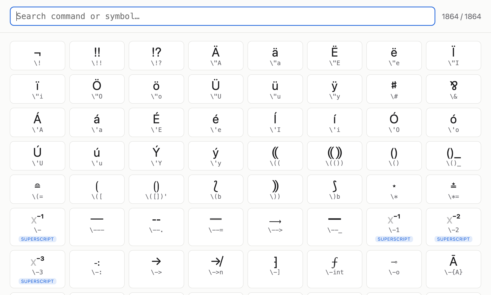

# ProverSymbolsInput

Type unicode abbreviations from the proof assistant you use, either [Lean 4](https://lean-lang.org)
or [Agda](https://agda.readthedocs.io), in any macOS app, with a searchable cheat sheet on
**⌃⌥⌘L**:

| Symbol | Lean 4  | Agda    |
|--------|---------|---------|
| →      | `\to`   | `\to`   |
| ∀      | `\all`  | `\all`  |
| ≡      | `\==`   | `\==`   |
| ℝ      | `\R`    | `\bR`   |
| ℕ      | `\N`    | `\bN`   |

You choose one proof assistant's table when you install, and can switch at any time.

This repo works in conjunction with
[Math Symbols Input](https://github.com/knrafto/MathSymbolsInput), a macOS input method that turns
`\commands` into unicode characters in whichever app has keyboard focus. Math Symbols Input does
the typing; this repo loads the Lean 4 or Agda abbreviation table into it and adds the cheat sheet.



## Install

1. Download and install [MathSymbolsInput.pkg][pkg], then log out and back in. If the package
   doesn't work, see the original [Math Symbols Input](https://github.com/knrafto/MathSymbolsInput)
   repo.
2. Run:

   ```sh
   ./install.sh            # Lean 4
   ./install.sh --agda     # Agda
   ```

   Add `--update` to fetch the latest table first.

This adds every Lean 4 or Agda abbreviation to Math Symbols Input's **Custom Commands** (your own
are kept; the table wins on a name clash). Running it with the other option switches tables and
removes the previous table's commands. Where Agda offers several symbols for one key, the first (Agda's default) is used.
It also installs the **Open Symbol Shortcuts** Quick Action (the cheat sheet, for either table).
Re-run it to refresh the cheat sheet.

Preferences are backed up to `~/Library/Application Support/ProverSymbolsInput/` first. To undo:
`defaults import com.mathsymbolsinput.inputmethod.MathSymbolsInput <backup.plist>`.

`abbreviations.json` is from [leanprover/vscode-lean4](https://github.com/leanprover/vscode-lean4)
(Apache License 2.0). `abbreviations-agda.json` is flattened from the `keymap.js` in
[banacorn/agda-mode-vscode](https://github.com/banacorn/agda-mode-vscode) (MIT), itself generated
from Agda's Emacs `agda-input.el`.

[pkg]: https://github.com/knrafto/MathSymbolsInput/releases/latest/download/MathSymbolsInput.pkg
